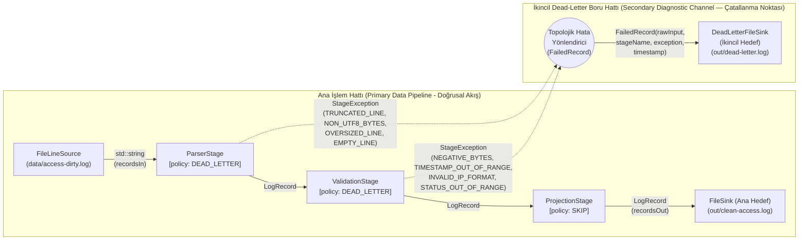

# LogFlow Mimarisi — Artım 5: Hata Yönetimi, Doğrulama ve Dead-Letter Kanalı

## 1. Artım 5 Mimari Odak ve Hedefler

LogFlow projesinin 5. Artımı, hata yönetimini basit bir `try/catch` veya *"hatalı satırları sessizce atla"* (silent skip) alışkanlığından çıkararak **birinci sınıf bir mimari ve topolojik tasarım konusu** olarak ele alır:

1. **Tasarlanmış Hata Stratejisi:** Bozuk log kayıtları sessizce yutulmaz; her aşama, karşılaştığı kayıt düzeyindeki hataları zengin tanılama bağlamıyla (`StageException`) bildirir.
2. **Topolojik Hata Yönlendirmesi (Topological Error Routing):** Bir hatanın nasıl ele alınacağı (`FAIL_FAST`, `SKIP`, `DEAD_LETTER`, `RETRY(n)`) aşamanın içindeki gömülü `if/else` veya `try/catch` bloklarıyla değil, boru hattının **topolojik bağlama katmanında (`PipelineBuilderStep` / `TopologicalStageRouter`)** kararlaştırılır.
3. **İkincil Kanal ve Çatallanan Topoloji (Dead-Letter Channel):** İşlem hattı artık yalnızca tek yönlü düz bir çizgi değildir; `DEAD_LETTER` politikası ile reddedilen kayıtlar `FailedRecord(rawInput, stageName, exception, timestamp)` nesnelerine dönüştürülerek ana çıktıdan bağımsız **ikincil bir Dead-Letter boru hattına (`Sink<FailedRecord>`)** yönlendirilir.
4. **Zarif Bozunma (Graceful Degradation):** Sağlam bir işlem hattı, bozuk verilerle (kesilmiş satırlar, UTF-8 olmayan baytlar, 100 KB'lık satırlar, negatif baytlar, 1970/2099 zaman damgaları) karşılaştığında çöküp durmak yerine, hatalı kayıtları yalıtarak geçerli kayıtları işlemeye devam eder ve çalışma sonunda tam sayısal mutabakat (`RunSummary`) sunar.

---

## 2. Hata Modeli: `StageException` vs. `PipelineException` (Görev 1)

Sistemde oluşabilecek hatalar, **kurtarılabilirlik (recoverability)** ve **etki alanı (scope)** açısından iki ayrı istisna sınıfına ayrılmıştır ([`PipelineExceptions.hpp`](PipelineExceptions.hpp)):

| Kriter | `StageException` (Kurtarılabilir Kayıt Hatası) | `PipelineException` (Kurtarılamaz İşlem Hattı Hatası) |
| :--- | :--- | :--- |
| **Kapsam ve Tanım** | Bir aşamada (`Stage`) **yalnızca tek bir kayıt (record)** işlenirken oluşan, diğer kayıtların işlenmesini engellemeyen veri/kural hatasıdır. | İşlem hattının (**Pipeline**) bütünüyle çalışmaya devam edemeyeceği sistem, G/Ç (I/O) veya yapılandırma hatasıdır. |
| **Kurtarılabilirlik** | **Kurtarılabilir (Recoverable):** Hata yalnızca ilgili kaydı etkiler. Topolojik yönlendirici kaydı aşamanın hata politikasına (`SKIP`, `DEAD_LETTER`, `RETRY(n)`) göre ele alır ve bir sonraki kayda geçer. | **Kurtarılamaz (Unrecoverable / Fatal):** Boru hattı derhal durdurulur, açık dosya/kaynak tanıtıcıları güvenli biçimde ters sırayla kapatılır (`close()`) ve hata üst katmana fırlatılır. |
| **Taşıdığı Bağlam** | `stageName` (aşama adı), `rawInput` (ham girdi satırı), `errorCode` (hata kategorisi kodu) ve `what()` açıklaması. | `componentName` (hatayı üreten bileşen: `PipelineLoader`, `FileLineSource`, `FileSink`, `DeadLetterFileSink`) ve hata nedeni. |
| **Somut Örnekler** | - Kesilmiş (truncated) CLF satırı (`TRUNCATED_LINE`)<br>- UTF-8 olmayan ikili bayt dizisi (`NON_UTF8_BYTES`)<br>- 100 KB'lık aşırı uzun tek satır (`OVERSIZED_LINE`)<br>- Negatif bayt sayısı (`NEGATIVE_BYTES`)<br>- 1970 veya 2099 tarihli zaman damgası (`TIMESTAMP_OUT_OF_RANGE`)<br>- Geçersiz IPv4 biçimi (`INVALID_IP_FORMAT`) | - YAML yapılandırma hatası (`ConfigValidationException : public PipelineException`)<br>- Kaynak log dosyasının bulunamaması veya okunamaması (`FileLineSource`)<br>- Çıktı dosyasının açılamaması veya **diskin dolması** (`FileSink` / `DeadLetterFileSink` yazma hatası)<br>- Bir aşamada `FAIL_FAST` politikasının tetiklenmesi |

---

## 3. Çatallanan Boru Hattı Topolojisi ve Dead-Letter Kanalı (Görev 3)

Artım 1–4'te işlem hattı `Source -> Stage 1 -> Stage 2 -> ... -> Sink` şeklinde **düz bir çizgi (linear pipeline)** idi. Artım 5'te **Dead-Letter Kanalının** eklenmesiyle birlikte mimari, **ana veri akışı (`LogRecord`)** ve **ikincil hata/tanılama akışı (`FailedRecord`)** olmak üzere iki bağımsız çıktı yoluna çatallanır:



> [!IMPORTANT]
> **Mimari Kırılma Noktası (Non-Linear Topology):**
> Yukarıdaki diyagramda kesikli çizgilerle (`-.->`) gösterilen çatallanma noktaları, işlem hattının düz bir çizgi olmaktan çıktığı yerdir. `ParserStage` ve `ValidationStage` kendi içlerinde nereye yazacaklarını bilmezler; yalnızca `StageException` fırlatırlar. `PipelineBuilderStep` içindeki `TopologicalStageRouter`, aşamaya tanımlanan `ErrorPolicy` değerine bakarak hatayı yakalar, `FailedRecord(rawInput, stageName, exception, timestamp)` nesnesini oluşturur ve ikincil `Sink<FailedRecord>` kanalına sevk eder.

---

## 4. Aşama Başına Ayarlanabilir Hata Politikaları (`ErrorPolicy` — Görev 2)

Her aşama için YAML yapılandırma dosyasında (`policy:` veya `onError:`) dört farklı hata politikası seçilebilir ([`ErrorPolicy.hpp`](ErrorPolicy.hpp)):

| Hata Politikası | YAML Gösterimi | Topolojik Davranış | Uygun Kullanım Senaryosu |
| :--- | :--- | :--- | :--- |
| **`FAIL_FAST`** | `policy: FAIL_FAST` | İlk `StageException` yakalandığında bunu `PipelineException` olarak yükseltir ve tüm işlem hattını derhal durdurur. | Sıfır hata toleranslı finansal/denetim boru hatları veya hata ayıklama. |
| **`SKIP`** | `policy: SKIP` | Hatalı kaydı sessizce düşürmek yerine `RunSummary` içindeki ilgili aşamanın `skippedCount` ve `droppedCount` sayaçlarını artırır ve sonraki kayda geçer. | Gürültülü ancak tanılaması saklanmak istenmeyen ön filtreleme/projeksiyon aşamaları. |
| **`DEAD_LETTER`** | `policy: DEAD_LETTER` | Başarısız kaydı `FailedRecord(rawInput, stageName, exception, timestamp)` içine sarar, `RunSummary::deadLetterCount` sayacını artırır ve ikincil `deadLetter` hedefine yazar. | Üretim (production) log işleme hatları, kaos testi, denetim ve adli hata analizi. |
| **`RETRY(n)`** | `policy: RETRY(3)` | `StageException` alındığında aynı kaydı ilgili aşamada en fazla `n` kez yeniden dener (`RunSummary::totalRetries` sayacını artırır). `n` deneme sonunda hala başarısızsa ikincil hedefe (`DEAD_LETTER`) yönlendirir. | 6. haftadaki harici G/Ç (GeoIP, DNS, veritabanı, HTTP zenginleştirme) aşamalarındaki geçici ağ hataları. |

---

## 5. Bildirimsel Doğrulama Aşaması (`ValidationStage` — Görev 3)

[`ValidationStage`](ValidationStage.hpp), yapısal olarak ayrıştırılmış `LogRecord` nesnelerini yapılandırma dosyasındaki bildirimsel kurallarla (`ValidationRules`) denetler:

```yaml
- type: validate
  policy: DEAD_LETTER
  params:
    requiredFields: [clientIp, method, path, timestamp]
    statusRange: [100, 599]
    bytesRange: [0, 104857600]
    timestampYearRange: [2000, 2035]
    validateIp: true
```

1. **Zorunlu Alanlar (`requiredFields`):** Belirtilen alanların (`clientIp`, `method`, `path`, `timestamp`, `userAgent` vb.) boş veya `"-"` olmamasını denetler (`MISSING_REQUIRED_FIELD`).
2. **Sayısal Aralıklar (`statusRange`, `bytesRange`):** HTTP durum kodunun `[100, 599]` aralığında (`STATUS_OUT_OF_RANGE`) ve bayt sayısının `[0, 104857600]` aralığında olmasını denetler; özellikle **negatif bayt sayılarını (`NEGATIVE_BYTES`)** yakalar.
3. **Zaman Damgası Tutarlılığı (`timestampYearRange`):** Kayıt yılının mantıklı sınırlar (ör. `[2000, 2035]`) içinde olmasını denetler; **1970 (epoch sıfırlanması)** ve **2099 (gelecek tarih sapması)** gibi tutarsız zaman damgalarını (`TIMESTAMP_OUT_OF_RANGE`) yakalar.
4. **IP Biçimi (`validateIp`):** İstemci IP adresinin geçerli bir IPv4 dörtlüsü (`0-255.0-255.0-255.0-255`) olmasını denetler (`999.999.999.999` gibi bozuk IP'leri `INVALID_IP_FORMAT` ile reddeder).

---

## 6. Kaos Testi: Bozuk Dosyadaki Hata Türleri ve Politika Eşleştirme Tablosu (Görev 5)

Hocanın sağladığı [`data/access-dirty.log`](data/access-dirty.log) (11 satır: 3 geçerli kayıt + 8 bozuk/yorum kaydı) ve [`data/access-empty.log`](data/access-empty.log) (0 bayt boş dosya) üzerindeki her hata türünün hangi aşamada yakalandığını, hangi istisna/kod ile sınıflandırıldığını ve hangi hata politikasıyla ele alındığını gösteren eşleştirme tablosu aşağıdadır:

| # | Satır No | Bozuk Dosyadaki Hata Türü (`data/access-dirty.log` & `data/access-empty.log`) | Dosyadaki Gerçek Girdi / Durum | Yakalayan Aşama | Fırlatılan İstisna ve Hata Kodu | Ele Alan Hata Politikası (`configs/chaos-test.yaml`) | Sistem Davranışı ve Hedef Yönlendirmesi |
| :--- | :--- | :--- | :--- | :--- | :--- | :--- | :--- |
| **1** | Satır 1 | **Başlık / Yorum Satırı (Header / Comment Line)** | `# Deliberately corrupted HTTP access-log fixture; see README.txt` | `ParserStage` (`parse`) | `StageException`<br>`code: COMMENT_OR_HEADER_LINE` | **`DEAD_LETTER`** *(veya `SKIP`)* | Geçerli bir CLF kaydı olmadığından `FailedRecord` olarak `out/dead-letter.log` hedefine yönlendirilir ve `RunSummary`'de hesaba katılır (`parse` dropped +1). |
| **2** | Satır 4 | **Kesilmiş Satır — Eksik Zaman Damgası (Truncated Timestamp)** | `192.0.2.44 - - [15/Oct/2026:10:18:` | `ParserStage` (`parse`) | `StageException`<br>`code: TRUNCATED_LINE` | **`DEAD_LETTER`** | İşlem hattı çökmez; kayıt `FailedRecord` içine sarılarak ikincil `out/dead-letter.log` hedefine yazılır (`parse` dropped +1). |
| **3** | Satır 5 | **Negatif Veri (Byte) Sayısı (Negative Response-Byte Count)** | `192.0.2.55 - - [15/Oct/2026:10:20:10 +0000] "GET /download HTTP/1.1" 200 -45 "-" "test-agent"` | `ValidationStage` (`validate`) | `StageException`<br>`code: NEGATIVE_BYTES` | **`DEAD_LETTER`** | `ParserStage` yapısal tamsayıyı (`-45`) ayrıştırır; `ValidationStage` bildirimsel `bytesRange: [0, 104857600]` kuralıyla yakalayıp `out/dead-letter.log` hedefine yönlendirir (`validate` dropped +1). |
| **4** | Satır 7 | **1970 Tarihli Zaman Damgası (1970 Epoch Timestamp)** | `192.0.2.70 - - [01/Jan/1970:00:00:00 +0000] "GET /old HTTP/1.1" 200 10 "-" "test-agent"` | `ValidationStage` (`validate`) | `StageException`<br>`code: TIMESTAMP_OUT_OF_RANGE` | **`DEAD_LETTER`** | `ValidationStage` bildirimsel `timestampYearRange: [2000, 2035]` kuralıyla 1970 yılını reddeder ve `out/dead-letter.log` hedefine yönlendirir (`validate` dropped +1). |
| **5** | Satır 8 | **2099 Tarihli Zaman Damgası (2099 Future Timestamp)** | `192.0.2.99 - - [31/Dec/2099:23:59:59 +0000] "GET /future HTTP/1.1" 200 20 "-" "test-agent"` | `ValidationStage` (`validate`) | `StageException`<br>`code: TIMESTAMP_OUT_OF_RANGE` | **`DEAD_LETTER`** | `ValidationStage` bildirimsel `timestampYearRange: [2000, 2035]` kuralıyla 2099 yılını reddeder ve `out/dead-letter.log` hedefine yönlendirir (`validate` dropped +1). |
| **6** | Satır 9 | **Kesilmiş Satır — Eksik Yanıt Boyutu ve Son Alanlar (Truncated Record)** | `198.51.100.9 - - [15/Oct/2026:10:19:10 +0000] "GET /broken HTTP/1.1" 200` | `ParserStage` (`parse`) | `StageException`<br>`code: TRUNCATED_LINE` | **`DEAD_LETTER`** | Yanıt bayt alanı eksik olduğu için `ParserStage` tarafından yakalanır ve `out/dead-letter.log` hedefine yönlendirilir (`parse` dropped +1). |
| **7** | Satır 10 | **UTF-8 Olmayan Veri / Bayt Dizisi (Non-UTF-8 Bytes in User-Agent)** | `192.0.2.200 - - [15/Oct/2026:10:22:00 +0000] "GET /bad-encoding HTTP/1.1" 200 50 "-" "\xFF\xFE\xFA"` | `ParserStage` (`parse`) | `StageException`<br>`code: NON_UTF8_BYTES` | **`DEAD_LETTER`** | RFC 3629 UTF-8 denetiminde yakalanır; bozuk baytlar `\xFF\xFE\xFA` biçiminde güvenli kaçışlanarak `out/dead-letter.log` hedefine yazılır (`parse` dropped +1). |
| **8** | Satır 11 | **100 KB'lık Tek Satır (100 KiB / 102.400 Bayt Tek Satır)** | `192.0.2.100 - - [15/Oct/2026:10:21:00 +0000] "GET /huge HTTP/1.1" 200 1 "-" "AAAA...(102.400 bayt)..."` | `ParserStage` (`parse`) | `StageException`<br>`code: OVERSIZED_LINE` | **`DEAD_LETTER`** | Regex yığın taşmasını (stack overflow) önlemek için `maxLineBytes: 65536` sınırıyla regex öncesinde yakalanır; özetlenerek `out/dead-letter.log` hedefine yönlendirilir (`parse` dropped +1). |
| **9** | — | **Boş Dosya (`data/access-empty.log` — 0 Bayt)** | Dosya boyutu `0 byte` (hiç satır yok) | `FileLineSource` (`source`) | İstisna fırlatılmaz (Sınır durumu / Edge-case) | **Normal Tamamlanma** | İşlem hattı çökmeden çalışmayı tamamlar; `recordsIn = 0`, `recordsOut = 0`, `deadLetterCount = 0` olarak tam mutabakatla raporlanır. |

### Kaos Testi Sayısal Mutabakat Özeti (`configs/chaos-test.yaml` -> `data/access-dirty.log`)
- **Gelen Kayıt Sayısı (`recordsIn`):** `11`
- **Ana Hedefe Çıkan Geçerli Kayıt Sayısı (`recordsOut` -> `out/clean-access.log`):** `3`
  1. `2026-10-15T10:15:32Z 192.0.2.10 GET /index.html 200 1234`
  2. `2026-10-15T10:16:05Z 198.51.100.22 POST /api/login 401 287`
  3. `2026-10-15T10:17:41Z 203.0.113.7 GET /images/logo.png 304 0`
- **Aşama Bazında Atılan Kayıtlar (`droppedPerStage`):**
  - `parse` aşaması: `5` kayıt (`DEAD_LETTER`: 1 başlık/yorum satırı, 2 kesilmiş satır, 1 UTF-8 olmayan bayt `0xFF 0xFE 0xFA`, 1 100 KiB satır)
  - `validate` aşaması: `3` kayıt (`DEAD_LETTER`: 1 negatif bayt `-45`, 1 yıl `1970`, 1 yıl `2099`)
  - `project` aşaması: `0` kayıt
- **Dead-Letter Kanalına Gönderilen Toplam Kayıt (`deadLetterCount` -> `out/dead-letter.log`):** `8`
- **Muhasebe Denklemi:** `11 (Gelen) == 3 (Çıkan) + 0 (Atlanan) + 8 (Dead-Letter: 5 parse + 3 validate)` -> **TAM TUTARLI (`DOĞRULANDI`)**

---

## 7. Çalıştırma Özeti (`RunSummary`) ve 8–9. Hafta Ölçüm Temeli (Görev 4)

[`RunSummary`](RunSummary.hpp) sınıfı, her çalıştırmanın (`Pipeline::run()`) sonunda otomatik olarak doldurulur ve ekrana yazdırılır:
- **Kayıt Muhasebesi:** `recordsIn`, `recordsOut`, `deadLetterCount`, `totalSkipped`, `totalFiltered`, `totalRetries` ve sıralı `std::vector<StageRunMetrics>` ile her aşamanın girdi/çıktı/atılan kayıt dökümü.
- **8–9. Hafta Performans ve Kıyaslama (Benchmarking) Hazırlığı:**
  - `std::chrono::steady_clock` (monotonik donanım saati) kullanılarak mikrosaniye (`getElapsedMicroseconds()`) ve milisaniye (`getElapsedMilliseconds()`) hassasiyetinde gerçek geçen süre (wall-clock time) ölçülür.
  - Saniyede işlenen kayıt hızı (**Throughput:** `getThroughputRecordsPerSec()`) otomatik hesaplanır. 8. ve 9. haftalarda yapılacak çok iş parçacıklı (multi-threaded) ve geri basınçlı (backpressure) boru hattı ölçümlerinde bu sınıf doğrudan temel metrik toplayıcı olarak kullanılacaktır.

---

## 8. Artım 4 Mirası: Yapılandırma Odaklı Birleştirme, `StageRegistry` ve `PipelineLoader`

> **Temel Kilometre Taşı (Artım 4):** Yeni bir işlem hattı (pipeline) oluşturmak için kodun yeniden derlenmesi (recompilation) gerekmemelidir.

### 8.1. Bildirimsel Yapılandırma Şeması (YAML Configuration Schema)

```yaml
pipeline:
  name: <string>                  # İşlem hattının mantıksal adı (ör. error-report)

  source:                         # Veri kaynağı tanımı (Zorunlu)
    type: <string>                # Kayıtlı kaynak türü adı (ör. file)
    params: { <anahtar>: <deger> } # Kaynağa özgü doğrulanmış parametreler

  stages:                         # Sıralı aşama listesi (Zorunlu, en az 1 aşama)
    - type: <string>              # Kayıtlı aşama türü (parse, validate, filter, project)
      policy: <string>            # Hata politikası (FAIL_FAST, SKIP, DEAD_LETTER, RETRY(n))
      params: { ... }             # Aşamaya özgü doğrulanmış parametreler

  sink:                           # Ana çıktı hedefi tanımı (Zorunlu)
    type: <string>                # Kayıtlı hedef türü adı (file, console)
    params: { <anahtar>: <deger> }

  deadLetter:                     # İkincil Dead-Letter hedefi tanımı (İsteğe bağlı - Artım 5)
    type: <string>                # Kayıtlı dead-letter hedef türü (file, console)
    params: { <anahtar>: <deger> }
```

### 8.2. Kayıtlı Bileşen Türleri ve Parametre Şeması Tablosu (`StageRegistry` — Switch-Free)

| Bileşen Kategorisi | `type` Adı | Gerçekleştirim Sınıfı | Akış Türü (`In -> Out`) | Zorunlu / İsteğe Bağlı Parametreler |
| :--- | :--- | :--- | :--- | :--- |
| **Source (Kaynak)** | `file` | [`FileLineSource`](FileLineSource.hpp) | `void -> string` | `path: string` |
| **Stage (Aşama)** | `parse` | [`ParserStage`](ParserStage.hpp) | `string -> LogRecord` | `format: "clf" \| "combined"`, `maxLineBytes: int` |
| **Stage (Aşama)** | `validate` | [`ValidationStage`](ValidationStage.hpp) | `LogRecord -> LogRecord` | `requiredFields`, `statusRange`, `bytesRange`, `timestampYearRange`, `validateIp` |
| **Stage (Aşama)** | `filter` | [`PredicateFilterStage`](PredicateFilterStage.hpp) | `LogRecord -> LogRecord` | `field: string`, `op: string`, `value: int \| string` |
| **Stage (Aşama)** | `project` | [`ProjectionStage`](ProjectionStage.hpp) | `LogRecord -> LogRecord` | `fields: list<string>` |
| **Sink (Ana Hedef)** | `file` / `console` | [`FileSink`](FileSink.hpp) / [`ConsoleSink`](ConsoleSink.hpp) | `LogRecord -> void` | `path: string` (`file` için) |
| **Dead-Letter Hedefi** | `file` / `console` | [`DeadLetterFileSink`](DeadLetterSink.hpp) / [`DeadLetterConsoleSink`](DeadLetterSink.hpp) | `FailedRecord -> void` | `path: string` (`file` için) |

### 8.3. Üç Farklı Yapılandırma Dosyası (Artım 4 — Yeniden Derlemeden Farklı Davranışlar)

Değiştirilmemiş aynı `./logflow` ikili dosyası, yeniden derlenmeksizin üç farklı Artım 4 yapılandırmasıyla üç farklı çıktı üretir:
1. **Hata Raporu ([`configs/error-report.yaml`](configs/error-report.yaml)):** `status >= 400` filtreler, `[timestamp, clientIp, status, path]` alanlarını `out/errors.txt` dosyasına yazar.
2. **API Trafiği Veri Çıkarımı ([`configs/api-traffic.yaml`](configs/api-traffic.yaml)):** `path startsWith "/api"` filtreler, `[timestamp, method, path, status, bytes]` alanlarını `out/api-traffic.txt` dosyasına yazar.
3. **İstemci Bazında Bant Genişliği ([`configs/bandwidth-by-client.yaml`](configs/bandwidth-by-client.yaml)):** `bytes >= 1024` filtreler, `[clientIp, bytes, path, status]` alanlarını `out/bandwidth-by-client.txt` dosyasına yazar.
